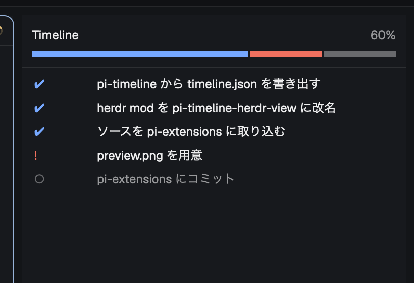

# pi-timeline-herdr-view



The agent's task plan from [pi-timeline](../pi-timeline), drawn inside a Herdr window: a segmented progress bar, the task tree with weighted shares, and a clicked task's note and result.

## What you see

- **Header, one row**: the tree's `title` on the left (or `Timeline`), the completed percentage on the right, and a `✕` only when the copy is an overlay window.
- **Progress bar**: one row of 6 px segments with 2 px gaps and 3 px radius, in the order done / in progress / blocked / pending. Segment widths are shares of the whole tree. No tasks: one flat `border`-coloured bar.
- **Tree**: one row per task, 2 px vertical and 6 px horizontal padding, 4 px radius. A 56 px status column holds the glyph and the indent (`depth × 12 px`), then the title, then `w<n>` when the weight is not 1. The row background is `selected` for the open task, and `hover` under the pointer.
- **Detail**: when a task is clicked, a panel under the tree (max 180 px, scrolls) shows the status glyph, the title, its share and weight, the `note` in `blocked` colour with a leading `!`, and the `result` in `muted` with a leading `→`.

## How it behaves

| Status | Glyph | Colour |
|---|---|---|
| `done` | `✔` | `done` |
| `active` | `▶` | `working` |
| `blocked` | `!` | `blocked` |
| `pending` | `○` | `dim` (title `muted`) |

- Clicking a row opens that task's detail; clicking it again closes the detail.
- The folder is reported by `watchFolder`, so a writer's save redraws without a timer.
- Long titles wrap; nothing truncates except the header.
- Nothing is editable: the mod never writes `timeline.json`.

## Built from

`mods/pi-timeline-herdr-view/`, one `main.js` and a `mod.json`:

```json
{ "place": "none", "title": "Timeline",
  "overlay": { "kind": "window", "key": "timeline", "width": 380, "height": 600 } }
```

- Imported from `herdr`: `readTextFile`, `watchFolder`, `props`, `focused`, `panes`, `spaces`, `home`, `theme`, `closeOverlay`. No `exec`, no `hc`, no network.
- Elements: `View` from `gpui-kit`; `v_flex`, `h_flex` from `gpui-base`; `flex_grow` for the bar segments, `overflow_y_scrollbar` for the tree and the detail.
- `folder()` resolves the file's folder: `props.file` → `props.cwd` → the focused pane's `cwd` → the active tab's first terminal `cwd` → the active space's `folder` → `home()`. A mod pane and an overlay have no folder of their own, which is why the chain exists.
- `layout()` builds the tree once per load: children by `parent`, a node's share is `weight / siblings' weight` times its parent's share, a leaf counts its share under its own status.
- Placement is the installer's choice; a permanent column needs a personal layout, because shipped layouts are read-only:

```json
{ "id": "timeline-panel", "type": "column", "hidden": true,
  "size": { "px": 380 }, "min": 260, "max": 900,
  "children": [{ "id": "timeline", "type": "block", "content": { "mod": "pi-timeline-herdr-view" } }] }
```

Add it to the `work-body` row of a cloned layout and bind `layout.toggle:timeline-panel`.

## Watch out

- `props()` has no folder for a mod pane or an overlay, and `focused()` can point at the mod itself. Resolving from `focused()?.cwd` alone made the mod look for `/timeline.json` at the filesystem root.
- Mod folders are copied by name. Two mods named `timeline` collide; this one is named after its package for that reason.
- Herdr reloads every copy on save, but a broken save keeps the previous version running and only reports in `herdr-app status`; always run `herdr-app check` before trusting the screen.
- `overlay.close` and a layout switch both close the window copy; the pane and column copies are separate and stay.
